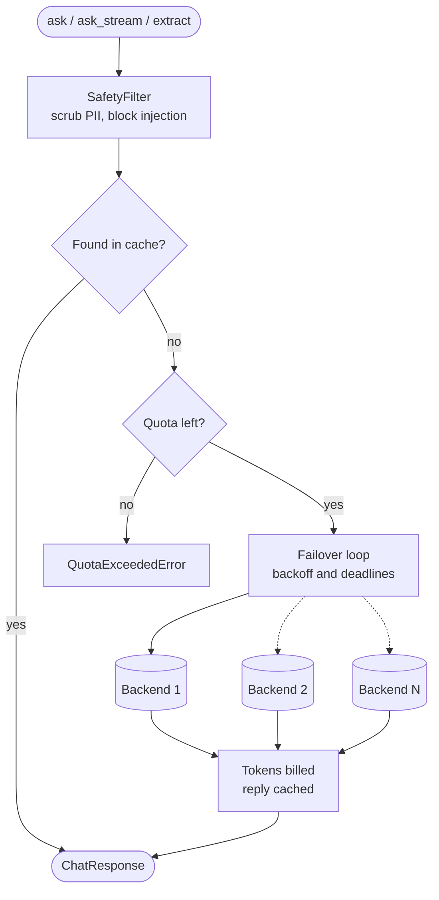
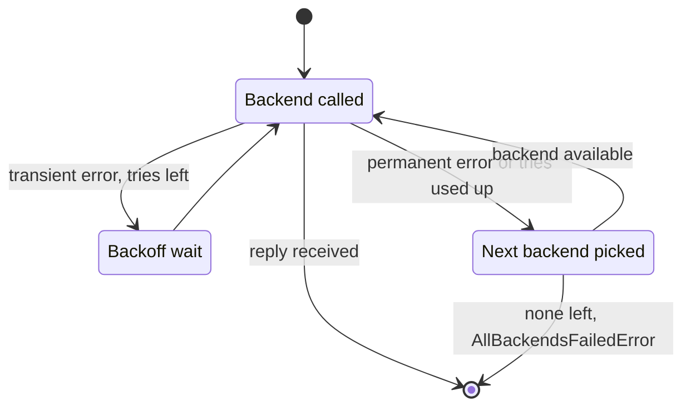
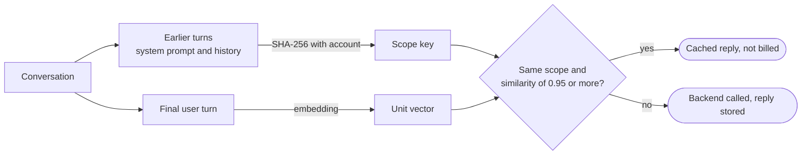

<p align="center">
  
</p>

<p align="center">
  <a href="https://github.com/lzradeel/llmgater/actions/workflows/ci.yml"></a>
  
  
  <a href="https://github.com/astral-sh/ruff"></a>
  
  <a href="LICENSE"></a>
</p>

<p align="center">
  <a href="#usage">Usage</a> ·
  <a href="#how-a-request-is-handled">Architecture</a> ·
  <a href="#failover-and-retries">Failover</a> ·
  <a href="#similarity-cache">Caching</a> ·
  <a href="#typed-outputs">Typed outputs</a> ·
  <a href="#quotas-and-safety">Quotas and safety</a>
</p>

<p align="center"><sub>2 runtime dependencies · 161 offline tests · mypy --strict · Python 3.11–3.14</sub></p>

A single async API is placed in front of OpenAI, Anthropic and any OpenAI-compatible server.

Slow, rate-limited or failing LLM APIs are absorbed by llmgater before the application is affected. Requests are screened for personal data and prompt injection, repeated questions are served from a cache, every account is held to its token quota, and a failed backend is replaced by the next one in line. When a Pydantic model is requested, a validated instance is returned, even if the first reply was malformed.

| Feature | What is provided |
| --- | --- |
| One API | The same `ask`, `ask_stream` and `extract` calls are used for every backend |
| Failover | Transient errors are retried with jittered backoff (`Retry-After` is honoured) before the next backend is tried |
| Timeouts | A deadline is applied per attempt, or per chunk while streaming |
| Similarity cache | Repeat prompts are matched by embedding and scoped per account and conversation |
| Token quotas | A cap is enforced per account and can be refilled on a schedule |
| Typed outputs | Replies are validated with Pydantic and repaired automatically |
| Safety filter | PII is redacted and prompt-injection attempts are blocked |
| Small footprint | Only `httpx` and `pydantic` are needed at runtime, and the code is fully typed |

## Install

```bash
pip install git+https://github.com/lzradeel/llmgater.git
```

Python 3.11 or newer is required.

## Usage

```python
import asyncio

from llmgater import AnthropicBackend, Gater, OpenAIBackend


async def main() -> None:
    backends = [OpenAIBackend("gpt-5-mini"), AnthropicBackend("claude-haiku-5-5")]
    async with Gater(backends) as gater:
        reply = await gater.ask("Explain backpressure in one paragraph.")
        print(reply.backend, reply.usage.total)
        print(reply.text)


asyncio.run(main())
```

Keys are read from `OPENAI_API_KEY` and `ANTHROPIC_API_KEY` unless `api_key=` is passed. Each optional feature is enabled by a single constructor argument:

```python
gater = Gater(
    backends,
    backoff=BackoffPolicy(attempts=3),
    timeout=30.0,
    cache=SimilarityCache(ttl=3600),
    quota=TokenQuota(fallback=100_000, period=86_400),
    safety=SafetyFilter(),
)
```

## How a request is handled



## Failover and retries

Each backend is tried in order. The decision made after every attempt is shown below:



Timeouts, connection errors, 408, 409, 429, 5xx and 529 are treated as transient. Any other 4xx is treated as permanent. Each attempt of `ask()` is capped by `timeout`; in `ask_stream()` the gap between chunks is capped instead, so long answers are not cut off while tokens keep arriving. A stream is only moved to another backend before its first token. After that point, the error is raised so that a silently restarted answer is never produced.

## Similarity cache



Only the final turn is matched by meaning. Everything before it is hashed together with the account name, so answers are never shared between accounts and a long shared system prompt cannot make two different questions look alike. The cache is skipped for a single call when `allow_cache=False` is passed.

| Embedder | Matches | Requirement |
| --- | --- | --- |
| `HashEmbedder` (default) | The same question with different casing or punctuation | None |
| `OpenAICompatEmbedder()` | Paraphrases of the same question | An OpenAI key or a compatible server |
| Custom | Whatever the model can match | An `async embed(text) -> list[float]` method |

## Typed outputs

```python
class Invoice(BaseModel):
    vendor: str
    total: float
    currency: str


invoice = await gater.extract("ACME Corp billed us 1,200.50 EUR for hosting.", Invoice)
```

The JSON schema is added to the system prompt and every reply is validated with Pydantic. Code fences, trailing commas and curly quotes are fixed locally first. If the reply is still invalid, the validation errors are sent back to the model. Two repair rounds are allowed by default (`repair_attempts=2`), after which `SchemaMismatchError` is raised.

## Quotas and safety

```python
quota = TokenQuota({"acme": 1_000_000, "trial": 20_000}, fallback=100_000, period=86_400)
gater = Gater(backends, quota=quota, safety=SafetyFilter(injection_cutoff=0.5))
```

An estimate of the prompt is checked against the quota before any backend is called. Real usage is billed afterwards, and cache hits are not billed. Usage is reset every `period` seconds, or never if `period` is left out. A `QuotaExceededError` is raised with `account`, `consumed` and `cap` attached.

Emails, phone numbers, Luhn-valid card numbers, US SSNs, IP addresses and API keys are replaced in user and assistant messages with tags such as `[REDACTED:EMAIL]`. User messages are also scored against weighted injection patterns, and `InjectionBlockedError` is raised above the cutoff. System messages are trusted and left unchanged. Both checks are heuristics: they are intended as a cheap first line of defence, not as a replacement for model-side safety.

## Backends

| Backend | Configuration |
| --- | --- |
| OpenAI | `OpenAIBackend("gpt-5-mini")` |
| Anthropic | `AnthropicBackend("claude-haiku-5-5")` |
| Ollama, vLLM, Groq, OpenRouter, Gemini | `OpenAIBackend(model, base_url=..., api_key=..., name=...)` |
| Tests | `ScriptedBackend(["first reply", "second reply"])` |

`OPENAI_API_KEY` is only sent to OpenAI's own host, so it is never leaked to a custom `base_url`. Other services can be supported by subclassing `Backend` or `HTTPBackend` and implementing `generate` and `generate_stream`.

Scripted replies and errors are replayed by `ScriptedBackend`, and every request it receives is recorded, so no network is needed in tests. A full offline tour is provided in [`examples/local_tour.py`](examples/local_tour.py), and a live run is shown in [`examples/live_example.py`](examples/live_example.py).

## Development

```bash
pip install -e . --group dev
pytest && ruff check . && ruff format --check . && mypy src
```

<details>
<summary><b>Project layout</b></summary>

```
src/llmgater/
├── core.py          Gater: ask, ask_stream, extract and the failover loop
├── backends/        Backend base class, HTTP helpers, OpenAI, Anthropic, scripted
├── backoff.py       jittered exponential backoff
├── caching.py       similarity cache and embedders
├── quota.py         per-account token quotas
├── safety.py        PII scrubber, injection scorer, SafetyFilter
├── typed_output.py  schema prompt and JSON repair loop
├── models.py        messages, requests, responses, usage
└── exceptions.py    error types
tests/               161 offline tests, run against ScriptedBackend
examples/            local_tour.py (offline) and live_example.py
```

</details>

## License

Released under the MIT License.
